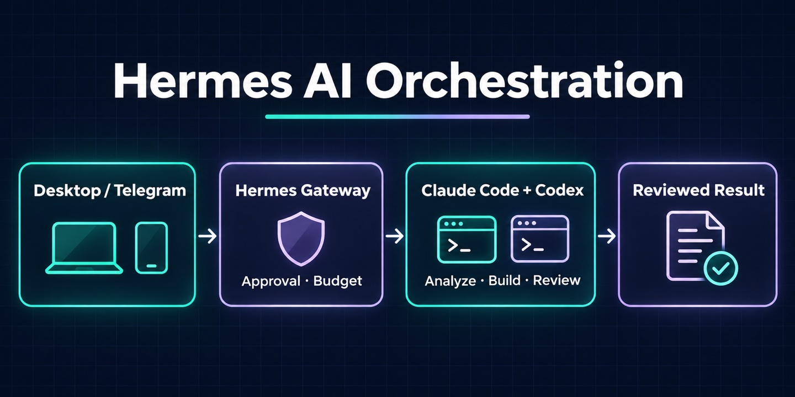

# Hermes AI Orchestration

**프로젝트 목표** · Desktop이나 Telegram에서 한 번 요청하면, Hermes가 승인과 예산을 관리하고 Claude Code와 Codex CLI가 분석·작성·독립 검증을 나누어 수행합니다. 사용자는 결과물과 검증 의견을 함께 확인할 수 있습니다.

Hermes를 중심으로 Desktop과 Telegram에서 작업을 접수하고, Claude Code와 Codex CLI가 분석·작성·검증을 나누어 수행하는 시스템의 설계 초안입니다.

Hermes는 요청을 실행 계획으로 만들고, 사용자 승인과 예산을 확인한 뒤 각 단계를 실행합니다. 사용자는 접수 채널에서 작업 상태를 조회하고, 실행 결과와 검증 의견을 함께 확인할 수 있습니다.

## Hermes 실행 환경

Desktop과 Telegram은 같은 작업 흐름을 이용하는 접수 채널입니다. 실행 호스트에서 Hermes Gateway와 오케스트레이션 플러그인이 요청을 처리하고, 사용자 승인과 예산 확인을 마치면 해당 호스트의 Claude Code 또는 Codex CLI를 단계별로 호출합니다. 실행기는 프로젝트별 작업 공간에 접근하고, Hermes는 작업 상태와 예산, 결과물과 검증 의견을 연결해 관리합니다.

`Desktop / Telegram → Hermes Gateway → 계획·승인·예산 확인 → Claude Code / Codex CLI → 결과·검증`

계획 검증에서는 두 실행 모드의 역할 배정과 승인 대기 상태를 모델 호출 없이 확인합니다. 실제 CLI 호출과 결과물 검증은 별도 승인 후 진행합니다. 채널별 권한과 호스트 구성은 [아키텍처](docs/architecture.md)에서 설명합니다.

## 실행 모드

| 실행 모드 | 분석 | 작성·수정 | 독립 검증 |
| --- | --- | --- | --- |
| Fixed · 기본 | Codex | Claude | Codex |
| Swap · 명시 선택 | Claude | Codex | Claude |

Swap은 기능이 활성화된 환경에서만 사용할 수 있습니다. 두 모드 모두 계획에 대한 명시적 승인이 필요합니다.

- [아키텍처](docs/architecture.md) · 채널, 실행기, 기록의 책임
- [오케스트레이션](docs/orchestration.md) · 계획, 승인, 패치 적용, 복구
- [보안 설계](docs/security-design.md) · 접근 제어와 작업 공간 보호
- [테스트 전략](docs/testing-strategy.md) · 단계별 합격 기준
- [로드맵](docs/roadmap.md) · 검증과 후속 개발 순서
- [워크플로 예시](examples/workflow-example.md) · 가상 작업의 접수부터 검증까지

이 문서 세트에는 설계와 검증 계획이 담겨 있습니다. 예시는 모두 가상이며, 구현 및 배포에 필요한 소스 코드와 운영 설정은 별도로 관리합니다.
