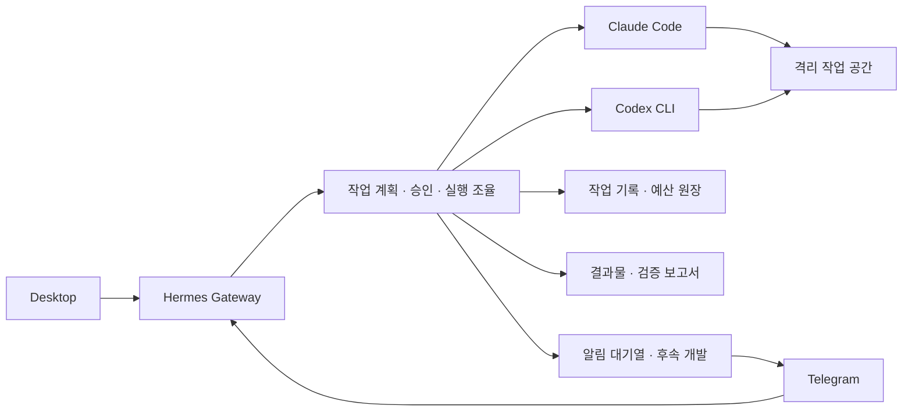

# 아키텍처

## 실행 환경과 요청 흐름

실행 호스트는 Hermes Gateway, 오케스트레이션 플러그인, Claude Code와 Codex CLI, 프로젝트별 작업 공간을 제공합니다. Desktop과 Telegram에서 들어온 요청은 Gateway에서 채널과 요청자 권한을 확인한 뒤 공통 작업 흐름으로 넘깁니다. 예산·복구 명령은 허용된 Telegram 개인 대화에서만 이용할 수 있습니다.

오케스트레이션 플러그인은 계획과 상태를 관리하는 작업 접수, 예산과 복구를 다루는 제어, 역할 배정에 따라 실행기를 호출하는 협업 실행을 담당합니다. 접수 후 계획이 승인 대기 상태에 들어가면 프로젝트 쓰기와 CLI 호출을 보류합니다. 승인된 작업은 분석·작성·독립 검증 순서로 진행하며 결과와 검증 의견을 같은 작업 기록에 연결합니다.

실제 실행 검증에서는 Gateway가 실행기를 호출하는 환경에서 각 CLI의 인증과 사용량 한도를 확인합니다. CLI 실행 가능 여부와 인증 상태는 실제 호출 성공과 별도로 확인합니다. Desktop 종료와 독립적인 Gateway 상시 운영, Desktop 요청의 Telegram 알림은 후속 검증·개발 범위입니다.

| 구성 요소 | 책임 |
| --- | --- |
| Gateway | 채널별 인증, 요청 접수, 상태 조회, 응답 전달 |
| 작업 조율 | 프로젝트와 모드 결정, 계획 생성, 승인·예산 검증, 단계 실행 및 복구 |
| 실행기 | 배정된 역할에 따라 분석 결과, 변경안 또는 검증 의견 반환 |
| 작업 기록 | 접수부터 완료까지 동일 작업 식별자로 계획, 승인 상태, 단계 결과 연결 |
| 예산 원장 | 호출 전 예약, 실제 사용량 정산, 실행 상태가 불명확한 호출의 예약 유지 |
| 프로젝트 작업 공간 | 파일 접근 범위 제한, 변경 검토, 결과물 보관 |

같은 요청의 재전송과 서로 다른 모드로 제출한 요청을 구분합니다. 접수에서 생성한 작업 식별자를 비동기 처리와 조회까지 전달합니다. 동일 요청의 Fixed와 Swap 계획은 서로 다른 작업으로 식별합니다.

공동 지식 저장소는 프로젝트별로 범위를 제한합니다. 인수인계 기록, 프로젝트 목록, 지식 노트의 자동 갱신은 별도 승인과 충돌 제어를 포함한 후속 과제입니다.
